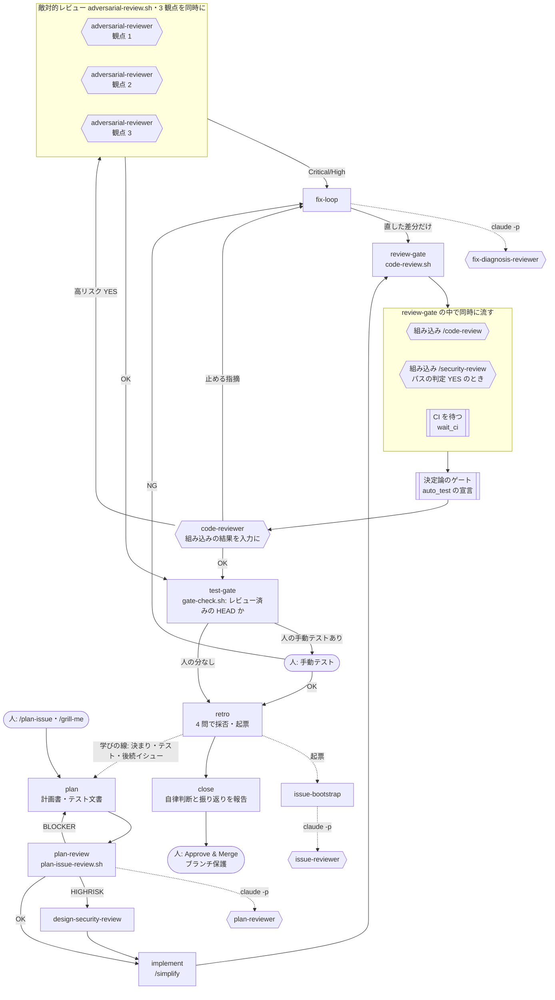

# I591 ハーネスの見直し: グラフエンジニアリングと渡された資料から取り入れるもの

- 調べた日: 2026-11-20
- 起点: #591（I591）。予備の見立ては #591 のコメント（2026-11-20「渡された資料の受け取りと予備の検討」）
- 範囲: 外部の解説 5 件と、ユーザーが渡した資料 10 件（x.com/beamnxw はユーザーの指示で対象外）。ハーネスの仕組みはこのイシューでは変えない
- 資料の読み方: X は Claude から読めない（WebFetch が HTTP 402・埋め込み用の窓口も 402・Playwright MCP は `.mcp.json:10` の `--allowed-origins` で手元のアプリだけ）。X の 5 件はユーザーが本文を貼り、ここには要約と短い引用だけを書く（公開リポジトリのため原文を写さない）。ほかは WebFetch で読んだ。#591 の本文とコメントの「X の 6 件を貼った」は数え違いで、正しくは 5 件

## 1. 外部の解説（グラフエンジニアリングとは何か）

| 出典（確認日 2026-11-20） | 要点 |
|---|---|
| Turing Post「FOD#159: Is Graph Engineering Real?」2026-07-20 https://www.turingpost.com/p/is-graph-engineering-real-why-everyone-is-talking-about-it | 定義: 作業を、タスク・エージェント・道具・検証役・共有の状態・人の判断からなる明示的なグラフとして設計すること。ループは前のノードに戻る道を持つグラフの一種。多くのエージェントは単一のループで足り、直線の流れは直線のままでよい。誇張の指摘: 「RAG を置き換えた」（GraphRAG は RAG の一種）・「Microsoft・Stanford・Anthropic が同時に発見」（DSPy は別物）・「Anthropic が打ち出した」（そのような分野・製品の発表は無い）・「精度 18% 向上・費用 85% 減」（特定の研究の結果で一般則ではない） |
| AI総研「グラフエンジニアリングとは？」2026-07-28 https://www.ai-souken.com/article/what-is-graph-engineering | ノード（実行単位・1 つの役割）・エッジ（順次・分岐・並列の分岐と合流・差し戻し・承認の関所）・状態（共有の作業机。スキーマを先に固める）。ループを内包する上位の概念。移る目安は「専門の分割・並列・監査のための制御の明示・成功基準の変化」のうち 2 つ以上 |
| AI Heartland「グラフエンジニアリングとは」2026-07-21（09-07 更新） https://ai-heartland.com/explain/claude-code-agent-graph-engineering/ | Claude Code の公式機能名ではなく設計の見方。実体はサブエージェントと dynamic workflows（`parallel()`＝全部そろうのを待つ・`pipeline()`＝待たずに流す）。「その "and then" は本当にエッジか」を各段階に問う。グラフ化は費用を減らす策ではない |
| AI Builder Club「Graph Engineering with Claude Code」2026-07-24（08-03 更新） https://www.aibuilderclub.com/blog/graph-engineering-with-claude-code | ノード＝サブエージェント（`.claude/agents/`）・エッジ＝指揮役のルーティング・モデルに任せない遷移はフック。Anthropic の multi-agent research は単一エージェントを 90.2% 上回ったが約 15 倍のトークン。分けられる仕事にだけ価値がある。弱いノードを並列にしても質は上がらない |
| FrankX「Claude Agent Engineering: Loops, Workflows and Graphs」2026-08-24 https://www.frankx.ai/blog/graph-engineering-claude-code | 「graph engineering」は筆者の便宜上の総称で公式の方法論ではない。ループ＝どう繰り返すか・ワークフロー＝順序と分岐をコードで持つ・グラフ＝実行/文脈/制御の 3 層で捉える見方。CLAUDE.md は短く、厳しい制約はフック・権限で。生成と公開の間に独立した証拠の関所 |

## 2. 渡された資料 10 件の要点

1. **x.com/m4lkxx/status/2114338456750997922**（本文を貼った）: Harness（何ができるか）・Loop（何が本当か）・Graph（次に何をするか）を 7 段のはしごとして説明。各段は下の段の決まった壊れ方から生まれる。証拠の強さは「決定論 > 観測した記録 > 別の文脈のレビュー > 自己申告」。確かめが受け入れる最も弱い証拠が確かめの強さ。直す前に再現テストが落ちるのを一度見る。失敗の手がかりに EXPECTED・SAW・FENCE（触ってよい範囲）・DEAD ENDS（試してだめだったこと）。同じ結果が 2 回出たら止めて上げる。通ったノードは凍結し落ちたノードだけやり直す。関所は取り消しの値段で決める（1 クリックで戻せる／後始末が要る／戻せない＝人が署名・点数の閾値なし）。教訓は持ち主の層に置く
2. **x.com/0xTrackmind/article/2113644871529418857**（本文を貼った）: Agent = Model + Harness。7 つの失敗と直し方（契約に「Done when」と「止まれ」・案内は 40 行ほどの地図・証拠を完了の関所に・作る役と確かめる役を分ける・権限はモデルの外・失敗を種類で分け回数に上限・状態は会話の外・教訓を説明→チェックリスト→自動の確かめ→強制へ）。確かめ役の問いに「テストを消す・スキップする・弱めて緑にしていないか」。案内の各行は事故に遡れること。数字（受け入れ 8→16 件など）は筆者 1 人の 1 回の記録で根拠として弱い
3. **x.com/sermakarevich/status/2123078038598365335**（本文を貼った）: 評価を先に書く開発。エージェントは同じ入力で動きが変わるので「何割通るか」で見る。試験の組は実際の失敗から作り、すべき・してはいけない・壊れてはいけないの 3 種。決まりで判定できるものはコード、読まないと決まらないものだけモデルの評価役、人は「良い」の定義と評価役の監査。評価役は「必ず落とすべき悪い例の組」で試してから関所に使う。新旧は同じ件で比べ件ごとの反転を見る
4. **x.com/yyh_gl/status/2122974887757406492** → リンク先と推定 https://zenn.dev/nrs/articles/c777388530aa84（nrs「コードを読まずにマージするために必要なこと」2026-10-27）: 人がコードを読まずにマージするには、品質確認の仕組みに加え、見逃しが起きたときに組織が引き受ける合意と、人が止める条件の合意が要る。全 PR に一律でなくてよい。抜き取りで定期的に品質を確かめる
5. **x.com/ClaudeDevs/status/2122801681939234950** → リンク先と推定 https://code.claude.com/docs/en/code-mode（公式・Code Mode）: 実験的機能。Claude が JavaScript を書き、複数の道具の呼び出しを 1 歩で行う。`claude -p` では使えない。JavaScript とファイル・Web・MCP の呼び出しはサンドボックスの外で動く。auto モードの判定役はコード全体を見て、実行時に決まる値は見ない。フックはコマンドの各部分を確かめる必要がある
6. **x.com/vincent_koc/status/2122443715440689638** → リンク先と推定 https://vincent.build/openclaw-ci-cost-reduction/（Vincent Koc「Making OpenClaw CI faster and 95% cheaper」2026-11-17 更新・ページの先頭 10 万字を読んだ）: 指標は PR からマージまでの時間。不要なテストを消す・確かめの時機を分ける（PR ではマージに要るものだけ）・自動レビューは PR ごとに 1 回・変更に関係するテストだけ流す（依存が分からなければ広げる・選んだ理由を記録）。施策ごとの寄与は分けられていない（記事自身の注意）
7. **https://claude.dev/blog/how-the-claude-code-team-thinks-about-verification/**（公式・Addy Osmani・2026-11-16）: Claude Code チームのコードの約 90% は Claude が書きレビューする。3 回で直らなければ止めて人を呼ぶ。差分を引き金にしたチェックリスト（39 項目・各項目にもとの障害や PR）。レビュー役は 1 人で回を重ね、2 人目を重ねるより主の役を調整する。**変更が自分を判定する確かめを変えられないようにする**（REVIEW.md は PR の変更からでなくベースのブランチから読む・レビューはコミット単位）。新しい関所は off/observe/enforce で observe から。確かめ自体を試す（正解つきの過去の事例・安定した変更を対照群・調整用と評価用を分ける）。不安定なテストはスキップ・sleep・再試行で通さない。決まりは定期的に刈る
8. **x.com/hanakoxbt/status/2091515787366306154**（本文を貼った）: ループはノードの中、グラフはノードの間。各矢印に「次の段は前の段の出力を本当に読むか」。ノードは分ける役・作業役・コードのノード・関所の 4 種（判断・評価・要約と言わずに書ける処理はコード）。作業役は自分の文脈で（共有の文脈だと最初の意見に寄る）。戻り道は直しの線（今回を直す）と学びの線（以後を直す）。戻すのは単位で、範囲（SCOPE）を付ける。関所は自信でなく取り消しの値段で開ける。人は戻しにくい 1 か所だけに置く
9. **x.com/addyosmani/status/2117512471930167377**（本文を貼った）: 認知の明け渡し（cognitive surrender）に注意。緑の確かめは 1 つの性質しか示さない（何を証明し、何を証明していないかを問う）。完了の知らせは要約より先に実行したコマンドと出力を見る。AI が自分で決めたこと（既定値・範囲の外にしたもの）を一覧させる。保証できる以上に作らない
10. **https://claude.com/ja/resources/articles/building-agents-when-to-fold-subagents-into-your-main-agent-loop**（公式・Diane Sarkis・2026-10-22）: サブエージェントは減らし、スキルと道具で必要なときだけ文脈を開く単一のループの方が品質・費用・待ち時間で勝ることが多い。残すのは検証・捨てられる文脈での並行・道具を選べないとき。継ぎはぎのプロンプト・乱立に注意。測る・1 つずつ変える・効果が示されたものを残す

## 3. 公式の言葉との対応（確認日 2026-11-20）

| 外の言葉 | Claude Code の公式の機能・言葉 | 出典 |
|---|---|---|
| ノード（作業の単位） | サブエージェント（`.claude/agents/`・`--agent`・`--agents`） | https://code.claude.com/docs/en/sub-agents.md |
| エッジ・分岐・並列（parallel / pipeline） | dynamic workflows（Workflow ツール・`agent()`・`parallel()`・`pipeline()`・`phase()`。`claude -p` でも許可ルールがあれば動く・同時 16・1 回 1,000 体） | https://code.claude.com/docs/en/workflows.md |
| モデルに任せない遷移・関所 | フック（PreToolUse・PostToolUse） | https://code.claude.com/docs/en/hooks.md |
| 並列の手段の使い分け | Run agents in parallel（subagents・agent view・agent teams・workflows） | https://code.claude.com/docs/en/agents.md |
| harness / loop | 公式の記事は「ハーネス」「検証ループ」を使う | 資料 7・10 |
| graph engineering | **公式の名前ではない**（資料 1 の外部の解説のうち Turing Post・AI Heartland・FrankX が明記） | 1 節 |
| 判定の決まりをベースのブランチから読む | 公式ブログ（資料 7）の運用。Claude Code の機能としては、プロジェクトのサブエージェントは作業ディレクトリからリポジトリのルートまでの `.claude/agents/` から読まれ、`--agents`（JSON）で別の定義を渡せる | 資料 7・https://code.claude.com/docs/en/sub-agents.md |
| Code Mode | 公式・実験的機能 | 資料 5 |

### 資料ごとの公式との対応（確認日 2026-11-20）

「公式の機能なし」＝運用の考え方で、対応する Claude Code の機能が無いもの。「未確認」＝公式の出典で確かめていない数字・主張。

| 資料 | 要点 | 対応する公式の機能・言葉 | 出典 |
|---|---|---|---|
| 外部・Turing Post | グラフ＝タスク・役・検証・状態・人の判断の明示的な設計。誇張の指摘 | サブエージェント・dynamic workflows・フック（「graph engineering」は公式の名前ではない）。誇張の否定は記事の主張で、公式の出典では未確認 | https://code.claude.com/docs/en/agents.md |
| 外部・AI総研 | ノード・エッジ・状態・分岐と合流・差し戻し | dynamic workflows（`agent()`・`parallel()`・`pipeline()`・`phase()`）。「状態のスキーマ」は `agent()` の `schema` に当たる | https://code.claude.com/docs/en/workflows.md |
| 外部・AI Heartland | 公式機能名ではない・実体はサブエージェントと dynamic workflows・"and then" は本当にエッジか | サブエージェント・dynamic workflows（`parallel()`＝全部を待つ・`pipeline()`＝待たない） | https://code.claude.com/docs/en/workflows.md |
| 外部・AI Builder Club | ノード＝サブエージェント・確実な遷移はフック・90.2% 上回り約 15 倍のトークン | サブエージェント（`.claude/agents/`）・フック。数字は未確認（記事の引用） | https://code.claude.com/docs/en/sub-agents.md ・ https://code.claude.com/docs/en/hooks.md |
| 外部・FrankX | ループ・ワークフロー・グラフの違い・同時 16・1,000 体 | dynamic workflows の上限（同時 16・1 回 1,000 体）は公式で確かめた | https://code.claude.com/docs/en/workflows.md |
| 1 m4lkxx | Harness・Loop・Graph のはしご・証拠の強さ・取り消しの値段で関所 | ハーネスの各部は公式の機能（サブエージェント・フック・権限・サンドボックス）に当たる。はしごの段・証拠の順・関所の考え方は公式の機能なし（運用の考え方） | https://code.claude.com/docs/en/agents.md |
| 2 0xTrackmind | 契約・地図・証拠の関所・権限はモデルの外・回数の上限・状態はファイルに | 権限はモデルの外＝公式の permissions・サンドボックス・フック。CLAUDE.md を短く＝公式の推奨（資料 10 の「システムプロンプトを 80% 以上削った」）。ほかは公式の機能なし。数字（8→16 件など）は未確認 | https://code.claude.com/docs/en/hooks.md ・資料 10 |
| 3 sermakarevich | 評価を先に書く・評価役を悪い例で試す | 公式の機能なし（運用の考え方）。公式ブログ（資料 7）の「確かめ自体を試す」と同じ方向 | 資料 7 |
| 4 Zenn（nrs） | コードを読まずにマージに要る合意 | 公式の機能なし（組織の運用の話） | — |
| 5 Code Mode | JavaScript で複数の道具の呼び出し・サンドボックスの外・`-p` 不可 | Code Mode（公式・実験的機能） | https://code.claude.com/docs/en/code-mode |
| 6 OpenClaw の CI | 不要なテストを消す・時機を分ける・関係するテストだけ | 公式の機能なし（CI の運用）。数字（95% など）は未確認（記事自身も施策ごとの寄与を分けていないと注意） | — |
| 7 公式ブログ（検証） | 3 回で人を呼ぶ・判定の決まりはベースのブランチから・observe から・確かめ自体を試す | 公式の運用（Claude Code チーム）。関係する機能はフック・`/goal`・Code Review | 資料 7 |
| 8 hanakoxbt | ループはノードの中・グラフはノードの間・戻すのは単位・取り消しの値段で関所 | サブエージェント（ノード）・dynamic workflows（ノードの間）。戻し方・関所の開け方は公式の機能なし（運用の考え方） | https://code.claude.com/docs/en/workflows.md |
| 9 addyosmani | 認知の明け渡し・緑が何を見ていないか・要約より先に証拠 | 公式の機能なし（人の習慣の話）。新しい文脈のサブエージェントで自分の仕事を批評させる点はサブエージェントに当たる | https://code.claude.com/docs/en/sub-agents.md |
| 10 公式記事（サブエージェントをまとめる） | 単一のループ＋スキル・道具が勝ることが多い・検証は残す | サブエージェント・スキル・MCP の道具（公式の記事） | 資料 10・https://code.claude.com/docs/en/sub-agents.md |

## 4. 今のハーネスの流れ（図）

- 本当の依存（矢印を外すと壊れるもの）: 計画レビュー → 実装、組み込みのレビューの結果 → code-reviewer、レビュー済みの HEAD → test-gate、テスト → retro → close → マージ
- 同時に流している所: 組み込みの /code-review・/security-review と CI 待ち（`scripts/claude/code-review.sh:1177`〜`1226`）、敵対的レビューの 3 観点（`scripts/claude/adversarial-review.sh:7`）
- 人がいる所: 起点（/plan-issue・/grill-me）・人の手動テスト・マージ・止めて聞く条件（`docs/runbooks/workflow.md:43`〜`45`）

## 5. 比較表（要点 × 今のハーネス）

判定: ○＝すでに満たしている／△＝差がある／×＝取り入れない（理由は 6 節）

| # | 要点（資料） | 判定 | 根拠（今のハーネス） | 経緯（差がある項目だけ） |
|---|---|---|---|---|
| 1 | 完了の定義を先に書く（契約・Done when・確かめを先に）（1・2・3・8・9） | ○ | イシューと計画書の受け入れ条件・結果で書く決まり（`docs/runbooks/plan-writing-rules.md:8`）・テスト文書を計画の段階で作る | |
| 2 | 証拠の強さの順（決定論 > 記録 > 独立のレビュー > 自己申告）（1・2・3） | ○ | 合否は台帳の行からスクリプトが決定論で出す（`.claude/skills/review-gate/SKILL.md:14`）・決定論のゲートを実走（`scripts/claude/code-review.sh:1216`〜`1222`）・レビュー役は別プロセス | |
| 3 | 作る役と確かめる役を分ける（2・7・9） | ○ | plan-reviewer・code-reviewer・adversarial-reviewer・fix-diagnosis-reviewer・issue-reviewer を `claude -p --agent` の別プロセスで（`scripts/claude/fix-review-lib.sh:79`〜`82`） | |
| 4 | **変更が自分を判定する確かめを変えられない**（7） | △ | レビュー役の定義は作業ツリー（＝PR のブランチ）の `.claude/agents/` から読む（`scripts/claude/fix-review-lib.sh:69`・公式: 作業ディレクトリからルートまでの `.claude/agents/`）。決定論の高リスク判定（`scripts/claude/code-review.sh:309`〜`318`）に `.claude/agents/`・`.claude/skills/`・`scripts/claude/`（見張りを除く）・`docs/runbooks/review-rules.md` は入っていない。LLM の高リスク判定も、この集合だけの変更は Yes にしないと明記している（`.claude/agents/plan-reviewer.md:221`・`scripts/claude/code-review.sh:304`〜`307`）。テストを消す・スキップする・弱める変更を確かめる観点もレビュー役の定義に無い（`.claude/agents/code-reviewer.md` に該当の記述なし） | I181（#304・2026-10-24）の設計確認で、敵対的レビューの費用（I179 で第 1〜11 周・延べ約 30 体・7 時間超、I180 で手順の追加だけで高リスク）を理由に、スキル・スクリプト・レビュー指示・`.claude/agents/`・review-rules.md を**意図して**集合から外し、「GitHub が最後の守り」と整理した。既存テストの変更・削除を見分ける判定も作らないと決めた（`docs/issues/closed/I181.md:18`・`:68`）。「判定の仕組みが自分を審査する」点は I181 では論じていない |
| 5 | レビュー役そのものを試す（必ず見つけるべき誤りの組・再現率）（3・7） | △ | 見張りには止めるべき形の一覧の試験がある（`scripts/claude/tests/guard_must_stop_cases.txt`・`docs/runbooks/danger-ops.md:80`）。LLM のレビュー役には無い | 見張りの一覧は I463（判定を弱める変更を CI で止める）で入った。レビュー役は「出力の形」の試験だけで、見つける力は測っていない |
| 6 | 新しい関所は記録だけ（observe）から始める（7） | △ | 一般の決まりは無い。見張りには「新しく確認・停止になったものが過去の作業の 1% を超えないか」の試験がある（`docs/runbooks/danger-ops.md:80`）。起票の自己完結度レビューはソフト警告（`.claude/skills/issue-bootstrap/SKILL.md:41`） | I200（#335）: 見張りの確認が多すぎて裏で動くレビュー役が止まった実例がある（`docs/issues/closed/I200.md`） |
| 7 | 戻すのは単位・範囲を付ける・通った所は凍結（1・8） | ○ | fix-loop は「止める指摘」だけ直す・やり直しは前の記録の `REVIEWED_COMMIT` からの差分だけ見る（`.claude/skills/review-gate/SKILL.md:14`・`:44`） | |
| 8 | 古いコミットへの合格を使わない（7） | ○ | `scripts/claude/gate-check.sh`（`docs/runbooks/workflow.md:54`） | |
| 9 | 関所は取り消しの値段で開ける（1・2・8） | ○ | 止めて聞く条件 2（`docs/runbooks/workflow.md:44`）・危険操作の承認・高リスクの敵対的レビュー・マージは人だけ（ブランチ保護） | |
| 10 | 回数の上限・同じ失敗が続いたら止める（1・2・7・8） | ○（上限は今のまま） | review-gate ⇄ fix-loop は 5 回目で止める（`.claude/skills/review-gate/SKILL.md:44`）・敵対的レビューは 2 周（同 `:55`）・同じ種類が 2 周続けば「止める場所・方式の見直し」を先頭に（同 `:84`・`docs/runbooks/review-rules.md:68`） | |
| 11 | 本当の依存だけを矢印に・同時に流せるものは流す（1・8・外部の解説） | ○ | 4 節の図。組み込みのレビューと CI 待ちは同時（`scripts/claude/code-review.sh:1177`〜`1226`）・敵対的レビューの 3 観点も同時。残る直列は本当の依存 | |
| 12 | 決まって答えが 1 つの処理はコード（1・3・8） | ○ | 合否・範囲・周回の数え方・台帳はスクリプト（`.claude/skills/review-gate/SKILL.md:14`・`:55`） | |
| 13 | 状態は会話の外（STATE.md）・中断から再開（1・2） | ○ | `STAGE_DONE:` の行と `scripts/claude/flow-stage.sh`（`docs/runbooks/workflow.md:52`〜`53`）・記録の文書 | |
| 14 | 案内は短い地図・詳細は必要なときに開く（2・10・外部の解説） | ○ | `CLAUDE.md` は 52 行で参照先の地図（`CLAUDE.md:9`） | |
| 15 | 教訓を仕組みにする・層ごとに置く（1・2・7・8） | ○ | retro の 4 問（実害・その場で捕まったか・決定論で足りるか・同梱できるか）（`.claude/skills/retro/SKILL.md:98`〜`102`） | |
| 16 | 決まり・手順の刈り込み・継ぎはぎの指示を避ける（2・7・9・10） | △ | I545・I546 で規約と進め方は見直した。スキルとレビュー役の指示は I547 で見直す予定 | I545〜I547（ハーネスの決まりの BP 見直し） |
| 17 | 確かめが何を見ていないかを人に見せる・要約より先に証拠（9） | △ | close の報告は自律判断と振り返りの要点（`.claude/skills/close/SKILL.md:175`）。「今回の確かめで見ていないこと」は無い | 設計確認メモでユーザーが採ると決めた |
| 18 | 変更に関係するテストだけ流す・依存が分からなければ広げる（6） | △ | #523（関係するハーネスのテストを機械で選ぶ）が開いている | #523 |
| 19 | 不安定なテストをスキップ・sleep・再試行で通さない（7） | × | 手順書に決まりは無い。ただし不安定なテストで通した実例は記録に見当たらない | |
| 20 | レビュー役は 1 人で回を重ねる（2 人目を重ねない）（7） | × | 組み込みの /code-review（正しさのバグ）と code-reviewer（受け入れ条件・計画・規約の照合）は見る観点が違う（資料 8 の「作業役は別の見方で」に当たる） | |
| 21 | サブエージェントを 1 つのループにまとめる（10） | × | 今のサブエージェントはどれも確かめ役で、別プロセスに分けるのが目的（記事が残すべきとする「検証」に当たる） | |
| 22 | dynamic workflows で流れを書き直す（外部の解説・資料 5 の隣の機能） | × | 敵対的レビューの同時起動はスクリプトの `claude -p` で動いている。Workflow は `claude -p` でも許可ルールで動くが、置き換えで得る速さは小さく、記録・判定のスクリプトを作り直す手間が大きい | |
| 23 | Code Mode（5） | × | 実験的・`claude -p` で使えない・JavaScript とファイル/Web/MCP の呼び出しがサンドボックスの外 | |
| 24 | コードを読まずにマージ（4） | × | マージの承認は人の仕事（CLAUDE.md の絶対ルール 2）。設計確認メモで回数の上限も今のままと決めた。代わりに 17 で判断の材料を足す | |
| 25 | 学習アプリ自体の評価を先に書く開発（3） | × | アプリは AI の製品ではない（ハーネスのレビュー役への応用は 5） | |

## 6. 採否と理由

採否の基準（計画書 4.）: 採る＝差を `ファイル:行` で示せて、実害の実例・守りを弱める種類・ユーザーの決定のどれかがある／同梱＝同じ目的の開いたイシューがある／取り入れない＝差が無い・実例が無く費用が効果を上回る・既存で足りる・ユーザーが取り入れないと決めた。

| # | 採否 | 理由（効果と危険） |
|---|---|---|
| 4 | **採る（起票・ハーネスの次の最優先）** | 守りを弱める種類（判定の仕組みを、判定される変更が書き換えられる）。効果: レビュー役・決まりの変更が、変更前の基準で審査される。危険: 判定の集合を広げると高リスクの周回が増え、費用と時間が増える。I593 は I181 の決定を見直す案で、集合を広げる方式は I181 が避けた費用の増加をそのまま戻すので、費用の増えない方式（定義・決まりを `origin/develop` から読む・テストを弱める差分を決定論で拾ってレビュー役に見せる）を先に比べる（#593 にコメントで訂正済み）。テストを消す・弱める変更の確かめも同じ種類なので同じイシューで扱う。直し方は守りの変更になるので、そのイシューでユーザーに確かめる（設計確認メモ） |
| 5 | **採る（起票）** | ユーザーの決定（毎回のレビューで流す・費用は承知の上）。効果: レビュー役・決まりを変えたときに見つける力の低下に気づける。危険: 毎回の費用と時間。最初は記録だけ（6 と合わせる） |
| 6 | **採る（5 のイシューに含める）** | 実例（I200: 新しい確認が多すぎて流れが止まった）。5 の問題集は新しい関所なので、記録だけから始め、誤検知を見てから止める側にする。一般の決まり（新しい関所は記録だけから）も同じイシューで手順書に書く。別のイシューに分けると決まりの置き場所が 2 つになる |
| 17 | **採る（起票）** | ユーザーの決定（「今回の確かめで見ていないこと」を 1〜3 行・小テストは付けない）。資料 9 の「要約より先に実行したコマンドと出力」も同じ報告の話なので、同じイシューで採否を決める |
| 16 | **同梱（I547）** | I547 がスキルとレビュー役の指示の BP 見直しを持つ。継ぎはぎの指示・重なりの点検（資料 10）を観点に加える。あわせて 4 を I547 より先に着手することを I547 に残す |
| 18 | **同梱（#523）** | #523 が同じ目的。「依存が分からないときは省かずに広げる・選んだ理由を記録する」（資料 6）を観点として加える |
| 10 | 取り入れない（上限は今のまま） | ユーザーの決定（5 回のまま）。同じ種類が 2 周続いたときの扱いはすでにある |
| 19 | 取り入れない | 不安定なテストで通した実例が記録に無い。決まりを足すと I545〜I547 の見直しと逆向き。実例が出たら retro の 4 問で扱う |
| 20〜25 | 取り入れない | 5 節の根拠のとおり（すでに別の観点で分けている・確かめ役は残す用途・置き換えの費用が大きい・実験的機能で守りの外・マージは人の仕事・アプリは対象外） |
| 1〜3・7〜9・11〜15 | 満たしている | 5 節の根拠のとおり。直すことは無い |

## 7. 起票・同梱したイシュー

| 種類 | 番号 | 題名 | 対応する比較表の行 |
|---|---|---|---|
| 起票（ハーネスの次の最優先・I547 より先） | #593（I593） | レビュー役・レビューの決まり・判定のスクリプト・テストを変える PR が、変えた後の基準で自分を審査できないようにする | 4 |
| 起票（I593 の後） | #594（I594） | レビュー役が見つけるべき誤りを見つけられるかを、問題集で毎回のレビューに記録する（新しい関所は記録だけから始める決まりも書く） | 5・6 |
| 起票 | #595（I595） | マージを頼む終了報告に「今回の確かめで見ていないこと」を 1〜3 行足す | 17 |
| 同梱（コメント） | #547（I547） | スキルとレビュー役への指示の BP 見直し | 16・4 を先に着手すること |
| 同梱（コメント） | #523（I523） | 変えたファイルに関係するハーネスのテストを機械で選ぶ | 18 |
